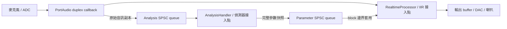

# Project 2：即時音訊 callback 與演算法 I/O

已建立麥克風 → C++ callback → 喇叭的 Project 2 管線，並直接重用
`quant-architect/include/quant/ipc/spsc_ring.hpp`。目前 DSP 是直通，偵測器是空實作；
IIR、嘯叫偵測及參數平滑演算法由公開介面接入。

## 資料流



兩個 queue 都使用同一份 `quant::ipc::SpscRing` template，各自有獨立 storage。
第二條 queue 的內容是**參數命令，不是輸出音訊**。播放不經過 analysis worker。
本階段使用同一 process 中的執行緒，不依賴 quant 專案的 Linux SHM manager，
也不建置或修改 quant 專案。macOS 上的驗證只涵蓋這個 header 的 process 內使用。

## 快速建置

需要 GCC／Clang、C++20、Make。預設從 `../../quant-architect` 取得 SPSC header；
若目錄不同，傳入 `QUANT_ARCHITECT_DIR`。

```bash
make -j2
make test
# 自訂相依目錄
make QUANT_ARCHITECT_DIR=/path/to/quant-architect
```

`make test` 執行自動測試和 `project2_sim`。模擬器以合成音訊呼叫同一個 callback
介面，驗證音訊直通以及分析 worker → 參數 queue → DSP 的接線，不開啟音訊裝置。
範例的固定參數命令用來示範 I/O，不會偵測或抑制嘯叫。

### 真實麥克風／喇叭

PortAudio 是可選的裝置相依套件。可使用現有 `pkg-config` 套件，或在專案內建置：

```bash
bash scripts/bootstrap_portaudio.sh
make live
./build/project2_live --help
./build/project2_live --list-devices
./build/project2_live --input 0 --output 1 --channels 1 \
  --sample-rate 48000 --frames 128 --seconds 10
```

請把 `0`、`1` 換成列出的裝置編號；省略 `--input`、`--output` 時使用預設裝置。
輸入／輸出使用相同聲道數及取樣率；裝置不支援指定組合會回報錯誤。
直通測試請使用耳機，避免麥克風與喇叭形成回授。macOS 可能要求麥克風權限。
按 Ctrl-C 或到達指定時間即停止串流，再停止分析執行緒。

Bootstrap 固定 PortAudio 19.7.0 官方 tarball 與 SHA-256，安裝到 `build/portaudio`，
不修改全域套件。腳本需要網路、curl、tar、Make、C toolchain；`make live` 另需
`pkg-config`（或明確設定 `PORTAUDIO_CFLAGS`、`PORTAUDIO_LIBS`）。Linux 需自行提供
所選 host API 的開發套件，例如 ALSA；本次裝置 adapter 建置驗證平台是 macOS arm64。

程式會顯示裝置回報的 input/output latency 與 xrun 計數。這不是聲學 round-trip
量測，也不代表已達成講義的端到端 ≤ 10 ms 目標。預設 48 kHz / 128 frames 的
callback 週期約 2.67 ms，尚須計入裝置延遲及排程餘裕。

### CMake

```bash
cmake -S . -B build-cmake -DQUANT_ARCHITECT_DIR=/path/to/quant-architect
cmake --build build-cmake -j2
ctest --test-dir build-cmake --output-on-failure
```

加入裝置程式時，在 configure 提供 `-DRT_AUDIO_BUILD_LIVE=ON`。若使用本地套件，
設定 `PKG_CONFIG_PATH="$PWD/build/portaudio/lib/pkgconfig"` 再執行 configure。

## 公開 I/O ports

介面集中在 `include/rt_audio/project2.hpp`。

| Port | 呼叫端／執行緒 | 輸入與輸出 |
|---|---|---|
| `Project2::process_callback` | 裝置 audio callback，唯一呼叫者 | float32 原音 → float32 輸出，附 frames、時間與狀態 |
| `RealtimeProcessor::prepare` | 啟動前的 control thread | 取樣率、聲道、預期 block 大小；在此配置 DSP 狀態 |
| `RealtimeProcessor::apply_parameters` | audio callback，block 開始 | 接收完整 `ParameterSnapshot`，最多呼叫一次／block |
| `RealtimeProcessor::process` | audio callback | `ProcessBlock`，填滿本次所有輸出樣本 |
| `AnalysisHandler::prepare` | 啟動前的 control thread | 初始化分析器與 rolling window |
| `AnalysisHandler::on_audio` | analysis worker | `AnalysisBlock` 原音副本；透過 `ParameterSink` 發送參數 |
| `ParameterSink::try_submit_parameters` | 唯一參數 producer | 非阻塞提交完整參數快照；失敗回傳 false |
| `Project2::statistics` | control／監控端 | 可並行讀取的計數器，不保證同一瞬間的整體快照 |

若已有自己的 worker loop，可直接使用 `try_read_analysis()` 及
`try_submit_parameters()`，並省略 `AnalysisWorker`。不要同時啟動兩個 consumer／producer。
UI 若要變更參數，必須先把操作交給 analysis worker，或另建一條 UI → worker 通道；
不能從 UI 與 worker 同時寫入同一條 SPSC。

### 音訊格式與生命週期

- 固定格式：interleaved float32，1 或 2 聲道；一個 frame 包含各聲道各一個 sample。
- `frames_per_buffer` 是預期大小；實際 `process_callback` 接受 1–2048 frames。
  DSP scratch 必須在 `prepare` 預留至 `max_frames`，不能只配置預設的 128 frames。
- `ProcessBlock::input/output` 只在該次 callback 有效，不得保留指標。
  Buffer 必須完全分離或起始位址完全相同，不支援部分重疊。
- `AnalysisBlock` 在 queue 內持有自己的固定大小樣本陣列。
  `on_audio` 收到的是 worker 重用的暫存，跨呼叫保留資料時需複製到分析器自己的 window。
  只讀取前 `frames * channels` 個元素，尾端不是有效音訊。
- `first_sample` 是已交付 frame 的累積索引，用來識別分析 queue 丟棄造成的缺口。
  裝置本身遺失樣本須一併檢查 `status_flags` 與 ADC timestamp；它不是硬體 sample clock。
- Null input 會使用預先配置的零值輸入，並標記 `input_missing`。
  無效 frames 或 null output 回傳 false，不碰 buffer；裝置 adapter 負責靜音及中止。
- 建構／準備 → 啟動 worker → 啟動音訊 → 停止音訊 → 停止並 join worker → 解構。
  生命週期方法只由單一 control thread 呼叫；worker instance 只允許啟動一次。
  `on_audio` 必須能返回，`stop()` 才能完成 join；不強制終止使用者演算法。

### 參數格式

`ParameterSnapshot` 是**完整設定**，不是增量操作：

- `revision`：非零且嚴格遞增；queue 滿時未接收的 revision 可以重試。
- `notch_count`：0–16；只有前 `notch_count` 個 notch 有效。
- 每個 `NotchTarget`：`frequency_hz`、`bandwidth_hz` 均須有限、> 0 且 < Nyquist；
  `depth_db` 是 0–120 dB 的正值衰減量。
- `bypass`：0 或 1；`transition_ms`：有限且介於 0–1000 ms。

這些是 transport 層的基本範圍驗證。演算法仍須驗證自己的濾波器穩定性與可用參數範圍。
`bypass`、`transition_ms`、notch targets 都交給 processor 解讀；引擎不代算 IIR 係數、
不實作 smoother，也不自動套用 bypass。預設 `PassthroughProcessor` 忽略所有參數。

每次 callback 最多取出 4 個快照，並只套用其中最新的一個。完整快照讓這種合併成立；
不能把 queue 用來發送「增加一個 notch」等不可省略的增量事件。
Worker 更新尚未送達時，processor 保留既有狀態；不會因 queue 空而重設濾波器。

## 如何接入自己的演算法

1. 繼承 `RealtimeProcessor`，在 `prepare` 建立 IIR bank 與 smoother 的全部儲存空間。
2. 在 `apply_parameters` 複製新目標；在 `process` 執行自己的平滑及濾波，完整寫入 output。
3. 繼承 `AnalysisHandler`，在 `on_audio` 收集分析視窗並呼叫自己的偵測器。
4. 偵測器產生完整 `ParameterSnapshot`，經 `ParameterSink` 提交。
5. 將 `apps/project2_live.cpp` 中的 `PassthroughProcessor`／`NoopAnalysisHandler`
   替換為自己的類別。先準備物件，再建立 `Project2` 和 `AnalysisWorker`。

最小接線：

```cpp
rt_audio::StreamConfig config{48000.0, 1, 128};
MyRealtimeProcessor processor;             // 使用者自己的 IIR / smoother
auto engine = std::make_unique<rt_audio::Project2>(config, processor);
MyAnalysisHandler detector;                // 使用者自己的偵測器
rt_audio::AnalysisWorker worker(*engine, detector);
worker.start();

// 裝置 callback 中：input/output 由音訊 backend 提供
bool ok = engine->process_callback(input, output, frames, timing);

// Control thread：先停止裝置，確定 callback 已返回
worker.stop();
worker.rethrow_if_failed();
```

`apps/project2_sim.cpp` 提供可編譯的固定參數發布範例。`noexcept` 不代表自動具備即時安全性；
使用者提供的 `apply_parameters`／`process` 也必須避免鎖、配置／釋放、I/O、等待及無界迴圈。

## 過載與失敗政策

| 狀況 | 行為 |
|---|---|
| Analysis queue 滿（32 blocks） | 丟棄新的分析副本、增加 `analysis_dropped`；原音仍送入 DSP／播放 |
| Parameter queue 滿（32 snapshots） | 提交回傳 false，增加 `commands_dropped`；worker 可保存最新完整快照稍後重試 |
| 參數不合法或 revision 過期 | 回傳 false，增加 `commands_rejected` |
| Worker 慢／停止／沒有新命令 | callback 持續使用 processor 現有狀態 |
| Worker 演算法拋例外 | 設定 `failed()` 並結束 worker；音訊路徑仍可運作，停止後由 `rethrow_if_failed()` 取回錯誤 |
| 裝置回報 input overflow／output underflow | 傳遞狀態並累加計數；不將其誤當為分析 queue drop |
| 裝置 callback 參數超出引擎契約 | PortAudio adapter 清空該輸出 buffer 並回傳 `paAbort` |

Queue 不擴容、不覆寫尚未讀取的資料、不在執行中 reset。Callback 內的核心操作不配置記憶體、
不鎖定、不等待；queue 的 copy 成本仍與固定訊息大小有關。原始 header 的 64-byte alignment
是既有布局假設，不代表所有處理器都達到最佳 cache 效能。

## 驗證範圍

`tests/project2_tests.cpp` 涵蓋 queue 邊界／回繞／跨執行緒資料完整性、音訊直通與格式邊界、
分析丟棄後的時間缺口、參數驗證與有界合併，以及 worker 啟停／錯誤傳遞。
功能測試與 sanitizer 檢查不能取代真實音訊裝置、最壞執行時間與端到端延遲量測。

本次驗證（macOS arm64、Apple Clang 17）：

- Make 嚴格建置及 10 組核心測試通過，包含 100,000 筆跨執行緒 queue 傳遞。
- 合成音訊端到端範例通過；CMake Release 含 live adapter 建置成功，CTest 2/2 通過。
- PortAudio adapter 已完成編譯連結，`--help` 與無效 CLI 參數拒絕已驗證。
- 尚未開啟真實麥克風／喇叭，未量測裝置延遲或驗證抑制效果。
- ASan/UBSan 與 TSan 無法完成驗證：此主機連空白 `main()` 的 sanitizer 探針也分別
  timeout／SIGSEGV；放寬執行 sandbox 後結果相同，不能宣稱 sanitizer 通過。

參考：[PortAudio callback 契約](https://portaudio.com/docs/v19-doxydocs/writing_a_callback.html)、
[PortAudio API](https://portaudio.com/docs/v19-doxydocs/portaudio_8h.html)。
