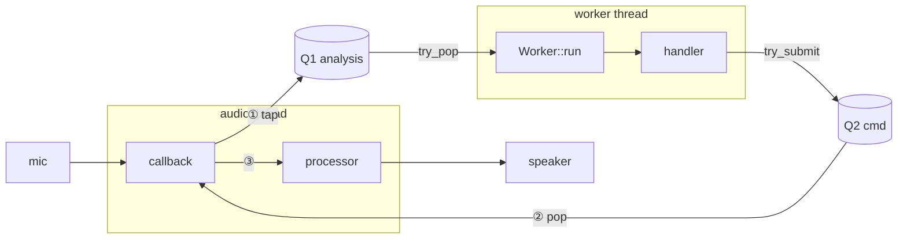

# rt-audio

C++20. Two standalone components.

| | arch | doc |
|---|---|---|
| P2 howling | cb DSP + bg analysis; SPSC → cmds | [P2](components/project2/README.md) |
| P3 key-click | in SPSC → bg DSP → out SPSC; fixed delay + dry fallback | [P3](components/project3/README.md) |

- P2: AHS via `release/ahs/`. Default = passthrough.
- P3: passthrough only. `rt_audio/project3.hpp`, ns/target `rt_audio::project3`. `./build/project3_sim`.
- `make test` = both. `make live` = both live apps.

Below = P2.

## Files

| path (`components/project2/…`) | what |
|---|---|
| `types.hpp` | audio/param/time/stats types |
| `processor.hpp` `src/processor.cpp` | `RealtimeProcessor`, passthrough |
| `analysis.hpp` | `AnalysisHandler`, `CommandSink<C>`, `ParameterSink` |
| `engine.hpp` `detail/engine_impl.hpp` `src/engine.cpp` | `AudioCallback`, `Engine<P>`, `CallbackPort`, `DefaultProtocol` |
| `worker.hpp` `detail/worker_impl.hpp` `src/worker.cpp` | `Worker<P>` |
| `detail/spsc_ring.hpp` | lock-free SPSC |
| `backends/portaudio/portaudio_device.cpp` | opt. device |
| `release/ahs/` | AHS releases, `rt_audio::ahs`, [SPEC](release/ahs/SPEC.md) |
| `apps/` | CLI, sims |

Targets `rt_audio::project2`, `rt_audio::project2_portaudio` (opt), `rt_audio::ahs`. Old names `Project2`, `AnalysisWorker` = aliases.

## Model



- Audio never in queue. Cb never waits.
- Cb: Q1 prod, Q2 cons. Worker: Q1 cons, Q2 prod. 1 writer/cursor → lock-free.
- Worker free-runs, polls, idle sleep 200 µs. Not woken by cb. Result ≥ next cb.
- Q full → drop newest. Threads only, no SHM.

## Protocol `P`

| member | |
|---|---|
| `Tap` `Command` | payloads, trivially copyable |
| `Processor` `Handler` `Sink` | cb DSP / worker / `CommandSink<Command>` |
| `tap_capacity` `command_capacity` | pow2 |
| `valid(cmd,cfg)` | checked at submit |
| `sequence(cmd)` | ≠0, strictly ↑, else reject |
| `deliver(h,tap,sink)` | worker |
| `callback(port,proc,block,missing)` | audio: tap + apply rule |

`DefaultProtocol` = old behaviour: raw pre-DSP tap written in slot (`try_write`, frames×ch only); `ParameterSnapshot`, ≤4 pop/cb, newest wins. Impl `detail/*_impl.hpp`, instantiated in `.cpp`.

## Build

```bash
make -j2
make test        # tests + project2_sim, no device
make component   # libs only
```

Live (PortAudio opt.):

```bash
bash scripts/bootstrap_portaudio.sh
make live
./build/project2_live --help            # lists AHS releases
./build/project2_live --list-devices
./build/project2_live --input 0 --output 1 --channels 1 --sample-rate 48000 --frames 128 --seconds 10
./build/project2_live --processor v7-c0291dd1e --gain 0.1 --frames 64 --latency 3
```

| opt | |
|---|---|
| `--processor` | `passthrough` (def) / `latest` / release. `latest` = lowlat-fir now. Bit-exact = `v7-c0291dd1e` |
| `--gain` | 0..1, def 0.1 (−20 dB, = AHS) |
| `--latency MS` | dev buffer req, 0<x≤1000; def = dev low; actual printed |
| `--frames` | 1..2048 |

- AHS ⇒ 48000 Hz. Passthrough ⇒ headphones. Speakers + AHS = real loop, start quiet.
- Bootstrap: PortAudio 19.7.0 + SHA-256 → `build/portaudio`. Needs net, curl, tar, make, cc, `pkg-config` (or `PORTAUDIO_CFLAGS`/`PORTAUDIO_LIBS`). Linux: host API dev pkg. Verified macOS arm64.
- Printed latency = dev-reported ≠ acoustic RTT ≠ E2E ≤10 ms proof.
- Stale `build/portaudio/.pc` (old path) breaks `make live` → rerun bootstrap.

CMake:

```bash
cmake -S . -B build-cmake
cmake --build build-cmake -j2
ctest --test-dir build-cmake --output-on-failure
```

Live: `-DRT_AUDIO_BUILD_LIVE=ON`. Local PA: `PKG_CONFIG_PATH="$PWD/build/portaudio/lib/pkgconfig"`.

## Ports

| port | thread | io |
|---|---|---|
| `AudioCallback::process_callback` | dev cb, sole | f32 in → f32 out + frames/time/status |
| `AudioCallback::statistics` | ctl | relaxed ctrs, not atomic snapshot |
| `RealtimeProcessor::prepare` | ctl, pre-start | alloc here |
| `::apply_parameters` | audio, block start | full snapshot, ≤1/block |
| `::process` | audio | write all out samples |
| `AnalysisHandler::prepare` / `on_audio` | worker | init / tap + sink |
| `CommandSink::try_submit` | sole cmd prod | non-block; false = reject/full |
| `PortAudioDevice(AudioCallback&, DeviceSelection)` | ctl | dev + `suggested_latency` |

- Own loop: `try_read_analysis()` + `try_submit()`, skip `Worker`. Never 2 prod/cons per queue. UI → via worker.
- f32 interleaved, 1–2 ch, 1–2048 frames; scratch sized `max_frames`.
- `ProcessBlock` ptrs: this call only. in/out disjoint or same.
- `AnalysisBlock`: first `frames*ch` valid, tail stale; buffer reused → copy to keep.
- `first_sample` → drop gaps. Dev gaps → `status_flags` + timestamps.
- null in → zeros + `input_missing`. Bad frames / null out → false, untouched.
- Order: prepare → worker start → dev start → dev stop → worker stop → destroy. 1 ctl thread. Worker 1-shot.

`ParameterSnapshot`: full cfg, not delta. `revision` ≠0 ↑. `notch_count` 0–16. freq/bw finite, 0<x<Nyquist; `depth_db` 0–120. `bypass` 0/1. `transition_ms` 0–1000. Transport check only; processor owns coeffs/smoothing/bypass.

## Add algo

| shape | do |
|---|---|
| A all in cb | `DefaultProtocol` + `RealtimeProcessor` |
| B bg analysis, notch params ok | + `AnalysisHandler` |
| C bg analysis, own types | own `P` → `Engine<P>` + `Worker<P>` |

```cpp
rt_audio::StreamConfig config{48000.0, 1, 128};
MyRealtimeProcessor processor;
auto engine = std::make_unique<rt_audio::Project2>(config, processor);
MyAnalysisHandler detector;
rt_audio::AnalysisWorker worker(*engine, detector);
worker.start();
bool ok = engine->process_callback(input, output, frames, timing);  // dev cb
worker.stop();               // after dev stop
worker.rethrow_if_failed();
```

`noexcept` ≠ RT-safe: no lock/alloc/IO/wait/unbounded loop. Example: `apps/project2_sim.cpp`.

## AHS (`release/ahs/`)

```cpp
#include <rt_audio/ahs.hpp>
auto s = rt_audio::ahs::make_session("v7-c0291dd1e", config, 0.1F);
rt_audio::PortAudioDevice device(s->callback());
s->start(); device.start();
device.stop(); s->stop(); s->rethrow_if_failed();
```

| release | arch | where | vs AHS |
|---|---|---|---|
| `v7-c0291dd1e` | callback | whole AHS in processor (Speex 48↔16, AFC, detect, notch, guard); ref = own out | bit-identical |
| `v7-split-c0291dd1e` | split | AFC/notch/guard in cb; `HowlingDetector` in worker. Q1 `Hop` 64-smp AFC out, Q2 `Detection` ≤8 cand, all applied in order | ≠ (1 cb late), run-to-run var |
| `v7-lowlat-c0291dd1e` | callback | = v7, pump runs engine on available smp (no 64-smp wait); engine/resampler untouched | ≠; open loop = v7 shifted 2.67 ms |
| `v7-lowlat-fir-c0291dd1e` | callback | lowlat + linear-phase FIR 48↔16 (111/97 taps) replaces Speex Q4; passes AHS R2 | ≠ (algorithm change) |

- `make_session` = all. `make_processor` = callback only (`latest` = newest callback). `latest` = `v7-lowlat-fir-c0291dd1e` today.
- Src AHS `codex/item2-round45-20261013` @ `c0291dd1e`. `upstream/` verbatim, SHA-256 in `PROVENANCE.md`. Multi-ver: macro ns rename + Speex `RANDOM_PREFIX`.
- Codebase audio latency (impulse, open loop): v7 6.67 ms (= Speex 4.0 + 64-smp wait 2.67); lowlat 4.00 ms (Speex only); lowlat-fir **2.15 ms** (FIR 1.15 + 1.00). E2E = this + dev in/out buffer. Smaller cb trims dev buffer only.
- New release → [SPEC §2](release/ahs/SPEC.md).

## Failure

| case | → |
|---|---|
| Q1 full (32) | drop new, `analysis_dropped++`, audio ok |
| Q2 full (32) | false, `commands_dropped++`, retry ok |
| bad/stale cmd | false, `commands_rejected++` |
| worker slow/dead | cb keeps state |
| worker throws | `failed()`, audio ok, `rethrow_if_failed()` |
| dev over/underflow | counted, ≠ queue drop |
| dev args bad | adapter silences, `paAbort` |

No queue growth / overwrite / mid-run reset. Cb: no alloc/lock/wait.

## Verified

- Tests: ring bounds/wrap/xthread, passthrough, format, gaps, param check + coalesce, worker lifecycle/errors.
- 2026-11-03 macOS 26.6 arm64 Apple clang Make: 24 PASS, `project2_live` builds, `notebook/bridge.cpp` compiles.
- AHS callback = `LivePipeline` bit-identical (closed loop, 480k smp, frames 32–512 + random). Split: sync = bit-identical; worker = 1-cb-late, 0 drop.
- NOT: CMake post-refactor (no cmake), sanitizers (host probes fail), real E2E latency, real rooms. AirPods: 0 xrun, ~525 ms dev-reported (BT).
- Tests ≠ WCET / E2E proof.

Refs: [PA callback](https://portaudio.com/docs/v19-doxydocs/writing_a_callback.html), [PA API](https://portaudio.com/docs/v19-doxydocs/portaudio_8h.html).
